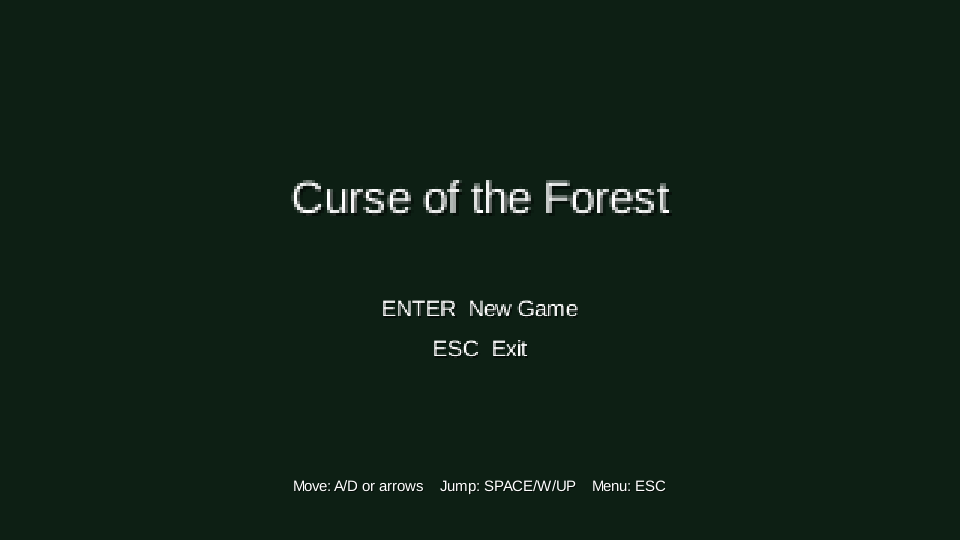
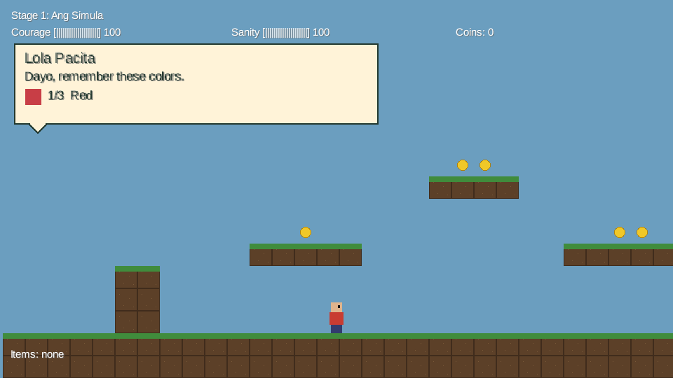
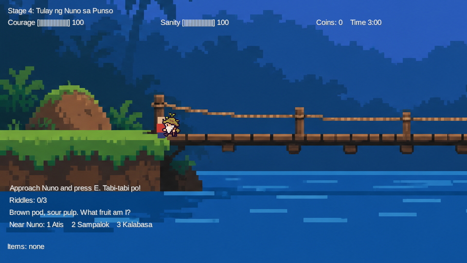
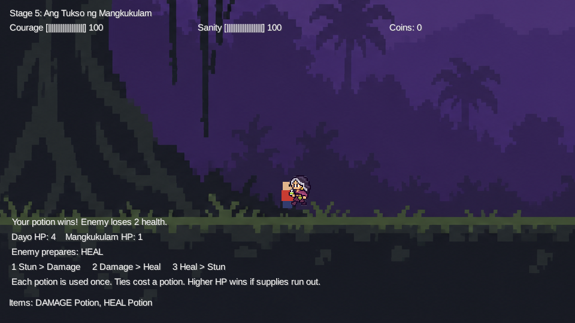

# Curse of the Forest

A 2D platformer adventure built with Java and LibGDX for OOP 101 (BatStateU, CS-2103) by Team CUPIDS (No. 6).

Dayo wants to court Luningning, but the road to her house runs through a forest ruled by creatures from Philippine folklore. Across five stages he must keep his Courage and Sanity up, collect coins, buy items from Duwende Tonyo, and beat a different mini-game in each stage.

> **Status: feature-complete (Nov 23, 2026).** The full journey plays from the main menu through the introduction, all five stages with their mini-games, the serenade and the ending, then back to the menu. Final art and UI polish are in progress.

## Problem addressed

Folklore and courtship traditions such as panliligaw are familiar names to young Filipinos but are rarely presented in an interactive form. The game also needs several challenges that all depend on the same player state, which calls for a structured object-oriented design.

## Objectives

1. Implement the five stages (Ang Simula, Ang Palengke ng Duwende, Ang Gubat ng Tikbalang, Tulay ng Nuno sa Punso, Ang Tukso ng Mangkukulam) with the intro, flashbacks, serenade and ending.
2. Build a LibGDX game with Tiled maps, platformer movement and one mini-game per stage.
3. Model Dayo's Courage, Sanity, coins and inventory so that items change later stages.
4. Use inheritance, abstraction, encapsulation and polymorphism where the game needs them.
5. Handle invalid actions and missing assets with exceptions instead of crashing.

## Target users

Filipino students and casual players interested in Philippine folklore and culture.

## Main features

- Five-stage story campaign framed by an introduction, two flashbacks, a serenade and one ending (Ang Sagot)
- Platformer gameplay on Tiled maps: run, jump, collect coins
- Courage and Sanity meters: the Wakwak's bites, wrong riddle answers and the Tikbalang's forest drain them; reaching 0 is a game over
- Lola Pacita's gifts (Rosary, Lumang Gitara) and Duwende Tonyo's shop with an inventory. The cave holds at most 10 coins, so Dayo must choose what to buy.
- One mini-game per stage:
  1. **Ang Simula:** repeat Lola Pacita's color sequence.
  2. **Ang Palengke ng Duwende:** collect coins while the Wakwak chases you, then shop.
  3. **Ang Gubat ng Tikbalang:** talk to the Tikbalang to start the clock, then hold E at glowing bushes to find the three pieces of the clue *"Baliktarin ang damit"* and escape.
  4. **Tulay ng Nuno sa Punso:** offer the right food for three riddles to earn three potions.
  5. **Ang Tukso ng Mangkukulam:** potion duel. Stun beats Damage, Damage beats Heal, Heal beats Stun. The witch hides her pick.
- Item effects that change later stages:
  - The Agimat gives 3 minutes instead of 1.5 in Stage 3.
  - The Itak (x2) or Punyal (x1.5) makes bush searches faster.
  - The Malunggay Juice gives 5 minutes instead of 3 in Stage 4.
  - The Rosary softens the Wakwak's bite.
  - The Kwerdas ng Gitara adds a line to the serenade.
- Game over with Retry, which restores Dayo's coins, stats and items to how they were when the stage began.

## Technologies used

- Java 21
- LibGDX 1.13.1 (desktop LWJGL3 backend only)
- Tiled map editor for levels (`.tmx`)
- Gradle 8.14 (wrapper included)
- JUnit 5 for unit tests

## How to run

Requirements: JDK 21. Everything else is downloaded by Gradle on the first run.

```bash
cd src
./gradlew lwjgl3:run        # Windows: gradlew.bat lwjgl3:run
```

Other commands (run from `src/`):

```bash
./gradlew test              # unit tests
./gradlew lwjgl3:jar        # runnable jar in lwjgl3/build/libs/
```

To open in IntelliJ IDEA: File > Open and select the `src` folder (the one with `settings.gradle`).

Controls:

| Key | Action |
|---|---|
| A/D or arrow keys | Move |
| Space/W/Up | Jump |
| E | Talk or interact (Stage 3: hold at a bush to search it) |
| 1/2/3 | Answer or choose (colors, offerings, potions) |
| 1-5 | Buy in the shop; U drinks the Malunggay Juice |
| Enter/Space | Advance a cutscene |
| Esc | Main menu |

On the game-over screen, **R** retries the stage and **M** returns to the menu.

## Project structure

```
curseoftheforest/
├── src/                     LibGDX Gradle project
│   ├── core/                game code (package com.cupids.curseoftheforest)
│   │   ├── ForestGame, AssetLoader
│   │   ├── player/          Player, Inventory
│   │   ├── stages/          GameStage + 5 stages, StageTimer, TileMap, Checkpoint
│   │   ├── screens/         MainMenuScreen, GameOverScreen, CutScene, Hud
│   │   ├── items/           Item, Weapon, Consumable, Accessory, Potion
│   │   ├── creatures/       Interactable, Creature + 6 creatures, GlowingBush
│   │   └── minigames/       Shop, InsufficientCoinsException, Riddle, PotionDuel, PotionType
│   ├── lwjgl3/              desktop launcher (Main)
│   └── assets/              maps/ (Tiled), images/
├── docs/                    UML class diagram
├── screenshots/
└── README.md
```

Tiled maps must have:

- a tile layer named `solid` (any tile there blocks movement);
- an object layer `coins` (rectangles);
- an object layer `markers` with rectangles named `spawn` and `exit`.

A stage may add its own named markers and object layers. Stage 3 (`gubat.tmx`) adds a `tikbalang` marker and a `bushes` layer. Image layers are decorative only. See `src/assets/maps/test.tmx`.

## Team members and roles

| Member | GitHub | Responsibilities |
|---|---|---|
| Sir Jairus Matthew M. Baldesco | [@sjmbaldesco](https://github.com/sjmbaldesco) | Main game class and screens, Player movement and stats, TileMap and collision, GameStage and stage transitions, StageTimer, Stage 3 (Tikbalang clue search). Coordinates tasks and deadlines. |
| Johndel M. Cuentas | [@jdvoid](https://github.com/jdvoid) | Item hierarchy, Inventory, Shop, InsufficientCoinsException, item effects, Stage 1–2 creatures and mini-game logic. |
| Phebe A. De Galicia | [@phiiibibii](https://github.com/phiiibibii) | Creature base, Stages 4–5 (Nuno, Riddle, Mangkukulam, PotionDuel), cutscenes and dialogue, HUD, AssetLoader, pixel art, input validation checks, UML, tests, README, presentation. |

## OOP concepts demonstrated

| Concept | Where |
|---|---|
| Encapsulation | `Player` keeps stats and coins private; `changeCourage()`/`changeSanity()` clamp to 0..100 and `spendCoins()` rejects overspending. `Inventory.getAll()` returns a read-only list. `GlowingBush` hides its search progress and gives its clue piece only once. `StageTimer` owns its paused/running state. Shop item names live in one place (`Shop.AGIMAT`, ...). |
| Inheritance | `ForestGame extends Game`; `GameStage`, `MainMenuScreen`, `GameOverScreen`, `CutScene` extend `ScreenAdapter`; five stages extend `GameStage`; `Weapon`/`Consumable`/`Accessory` extend `Item`; `Potion extends Consumable`; six creatures extend `Creature`. |
| Abstraction | `GameStage`, `Item` and `Creature` are abstract; `Interactable` is an interface shared by creatures and `GlowingBush` (a bush is not a creature, but Dayo interacts with both the same way). |
| Polymorphism | `ForestGame` holds the current stage as a `GameStage` and LibGDX calls `render()` on it; each stage overrides `init()`, `update()` and `handleInput()`, and Stage 3 overrides the drain hooks `courageDrainPerSecond()`/`sanityDrainPerSecond()`. `Item.use()` and `Interactable.interact()` are overridden per class: Tonyo opens the shop, Nuno asks riddles, the Tikbalang starts the timer, a bush starts a search. |
| Exception handling | `AssetLoader` catches missing images and uses a placeholder; `Player.useItem()` rejects items not in the inventory; `InsufficientCoinsException` for the shop. |
| Arrays and collections | `TileMap` copies the Tiled `solid` layer into a `boolean[][]` for collision; arrays hold the Stage 1 color pattern and the Stage 3 clue; `ArrayList` for coins, inventory, shop stock, bushes and the collected clue pieces. |

## Testing

`./gradlew test` (from `src/`) runs 37 JUnit 5 tests covering:

- player movement, collision and stats;
- the stage timer (including the paused Stage 3 clock);
- per-stage Courage/Sanity drain;
- Tiled map markers and the `gubat.tmx` map contract;
- bush searching with and without weapons, and the Tikbalang starting the timer;
- the Agimat timer, riddles, cutscenes and the potion duel (including a duel Dayo can lose).

Every stage was also smoke-run from the intro to the duel before release.

## Screenshots

| Main menu | Stage 1: Ang Simula | Stage 4: Tulay | Stage 5: Potion duel |
|---|---|---|---|
|  |  |  |  |

Screenshots of the introduction, Stages 2 and 3 and the ending will be added with the final art.

## Known limitations

- Single player, desktop only, one ending; items change timers and difficulty, not the story.
- Simple tile collision, not Box2D; no slopes.
- Duwende Tonyo's shop opens only in Stage 2, so coins found in Stage 3's bushes count toward Dayo's total but cannot be spent.
- The proposal listed Charm and Sincerity (and the code had Resistance) as Dayo's stats; no stage needed them, so they were left out rather than added without a purpose.
- The potion duel is partly luck: the witch picks at random, so a full-health Dayo wins about 63% of duels (Retry restores his potions).
- No sound or music.

## Future improvements

- Sound effects and music.
- A second visit to Tonyo's shop so Stage 3 coins can be spent.
- More hand-drawn decoration in the Tiled maps and animated sprites for every creature.
- A save system and a stage-select menu.

## AI use

The instructor allows AI tools for this project. The team used Claude (Anthropic) and Codex (OpenAI) to help write, review and explain code; the baseline and Stage 3 were built with Claude's help. Every member is responsible for understanding and being able to explain the code in their part.

## Contributors

See [Team members and roles](#team-members-and-roles) and the commit history.
