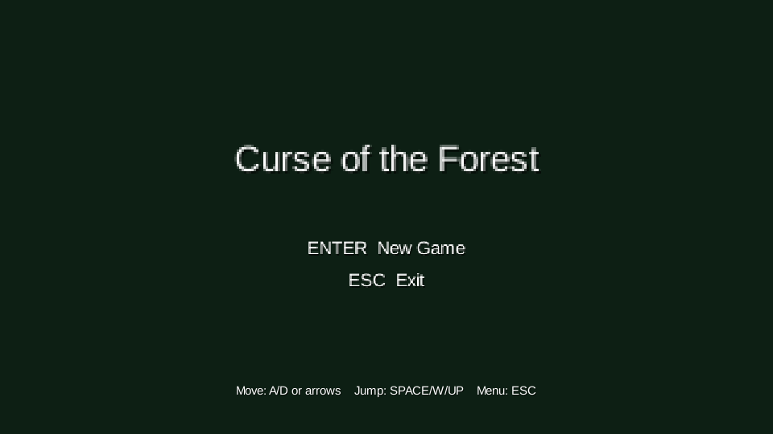
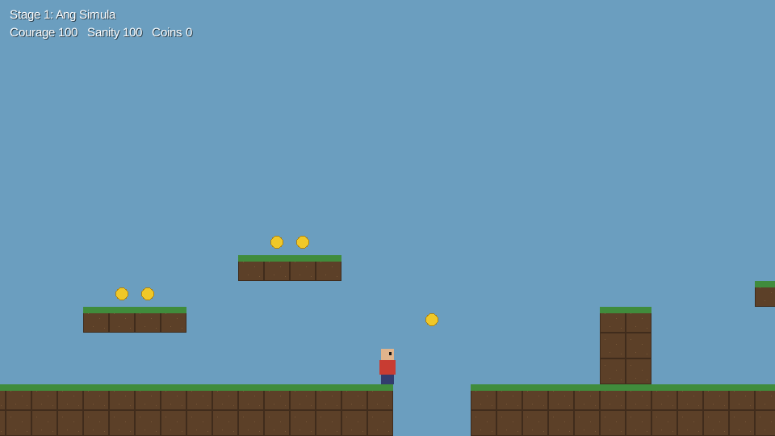

# Curse of the Forest

A 2D platformer adventure built with Java and LibGDX for OOP 101 (BatStateU, CS-2103) by Team CUPIDS (No. 6).

Dayo wants to court Luningning, but the road to her house runs through a forest ruled by creatures from Philippine folklore. Across five stages he must keep his Courage and Sanity up, collect coins, buy items from Duwende Tonyo, and beat a different mini-game in each stage.

> **Status: baseline.** The project builds and runs: main menu, Player movement with tile collision on a test map, the five stages in order (placeholders), stage timer, game over with retry. Stage mechanics, creatures, items, cutscenes and art are still to be built.

## Problem addressed

Folklore and courtship traditions such as panliligaw are familiar names to young Filipinos but are rarely presented in an interactive form. The game also needs several challenges that all depend on the same player state, which calls for a structured object-oriented design.

## Objectives

1. Implement the five stages (Ang Simula, Ang Palengke ng Duwende, Ang Gubat ng Tikbalang, Tulay ng Nuno sa Punso, Ang Tukso ng Mangkukulam) with the intro, flashbacks, serenade and ending.
2. Build a LibGDX game with Tiled maps, platformer movement and one mini-game per stage.
3. Model Dayo's Courage, Sanity, coins and inventory so that items change later stages.
4. Use inheritance, abstraction, encapsulation and polymorphism where the game needs them.
5. Handle invalid actions and missing assets with exceptions instead of crashing.

## Target users

Filipino students and casual players interested in Philippine folklore and culture.

## Main features (planned)

- Five-stage story campaign with cutscenes
- Platformer gameplay: run, jump, collect coins
- Courage and Sanity meters drained by hazards
- Duwende Tonyo's shop and an inventory
- A mini-game per stage: color sequence, Wakwak coin chase, timed clue search, riddles, potion duel
- Item-dependent timers (Agimat, Malunggay Juice)

## Technologies used

- Java 21
- LibGDX 1.13.1 (desktop LWJGL3 backend only)
- Tiled map editor for levels (`.tmx`)
- Gradle 8.14 (wrapper included)
- JUnit 5 for unit tests

## How to run

Requirements: JDK 21. Everything else is downloaded by Gradle on the first run.

```bash
cd src
./gradlew lwjgl3:run        # Windows: gradlew.bat lwjgl3:run
```

Other commands (run from `src/`):

```bash
./gradlew test              # unit tests
./gradlew lwjgl3:jar        # runnable jar in lwjgl3/build/libs/
```

To open in IntelliJ IDEA: File > Open and select the `src` folder (the one with `settings.gradle`).

Controls: **A/D** or arrow keys to move, **Space/W/Up** to jump, **Esc** for the menu. On the game-over screen, **R** retries the stage and **M** returns to the menu.

## Project structure

```
curseoftheforest/
├── src/                     LibGDX Gradle project
│   ├── core/                game code (package com.cupids.curseoftheforest)
│   │   ├── ForestGame, AssetLoader
│   │   ├── player/          Player, Inventory
│   │   ├── stages/          GameStage + 5 stages, StageTimer, TileMap, Checkpoint
│   │   ├── screens/         MainMenuScreen, GameOverScreen, CutScene, Hud
│   │   ├── items/           Item, Weapon, Consumable, Accessory, Potion
│   │   ├── creatures/       Interactable, Creature + 6 creatures, GlowingBush
│   │   └── minigames/       Shop, InsufficientCoinsException, Riddle, PotionDuel, PotionType
│   ├── lwjgl3/              desktop launcher (Main)
│   └── assets/              maps/ (Tiled), images/
├── docs/                    UML class diagram
├── screenshots/
└── README.md
```

Tiled maps must have a tile layer named `solid` (any tile there blocks movement), an object layer `coins` (rectangles), and an object layer `markers` with rectangles named `spawn` and `exit`. See `src/assets/maps/test.tmx`.

## Team members and roles

| Member | GitHub | Responsibilities |
|---|---|---|
| Sir Jairus Matthew M. Baldesco | [@sjmbaldesco](https://github.com/sjmbaldesco) | Main game class and screens, Player movement and stats, TileMap and collision, GameStage and stage transitions, StageTimer. Coordinates tasks and deadlines. |
| Johndel M. Cuentas | [@jdvoid](https://github.com/jdvoid) | Creature and Item hierarchies, Inventory, Shop, InsufficientCoinsException, Riddle, PotionDuel, stage mini-game logic. |
| Phebe A. De Galicia | [@phiiibibii](https://github.com/phiiibibii) | Cutscenes and dialogue, HUD, AssetLoader, Tiled level maps and pixel art, input validation checks, UML, tests, README, presentation. |

## OOP concepts demonstrated

| Concept | Where |
|---|---|
| Encapsulation | `Player` keeps stats and coins private; `changeCourage()`/`changeSanity()` clamp to 0..100 and `spendCoins()` rejects overspending. `Inventory.getAll()` returns a read-only list. |
| Inheritance | `ForestGame extends Game`; `GameStage`, `MainMenuScreen`, `GameOverScreen`, `CutScene` extend `ScreenAdapter`; five stages extend `GameStage`; `Weapon`/`Consumable`/`Accessory` extend `Item`; `Potion extends Consumable`; six creatures extend `Creature`. |
| Abstraction | `GameStage`, `Item` and `Creature` are abstract; `Interactable` is an interface shared by creatures and `GlowingBush`. |
| Polymorphism | `ForestGame` holds the current stage as a `GameStage` and LibGDX calls `render()` on it; each stage overrides `init()`, `update()` and `handleInput()`. `Item.use()` and `Creature.interact()` are overridden per subclass. |
| Exception handling | `AssetLoader` catches missing images and uses a placeholder; `Player.useItem()` rejects items not in the inventory; `InsufficientCoinsException` for the shop. |
| Arrays and collections | `TileMap` copies the Tiled `solid` layer into a `boolean[][]` for collision; `ArrayList` for coins, inventory and shop stock. |

## Screenshots

| Main menu | Test map (baseline) |
|---|---|
|  |  |

## Known limitations

- Single player, desktop only, one ending.
- Simple tile collision, not Box2D; no slopes.
- Baseline only: the five stages use the same test map and finish at the exit marker. Placeholder art.

## Future improvements

- Stage mini-games, creatures, shop and potion duel.
- Cutscenes, HUD meters, pixel art and Tiled maps for each stage.
- Optional sound and music.

## AI use

The instructor allows AI tools for this project. The team uses Claude (Anthropic) to help write and explain code; this baseline was scaffolded with its help. Every member is responsible for understanding and being able to explain the code in their part.

## Contributors

See [Team members and roles](#team-members-and-roles) and the commit history.
